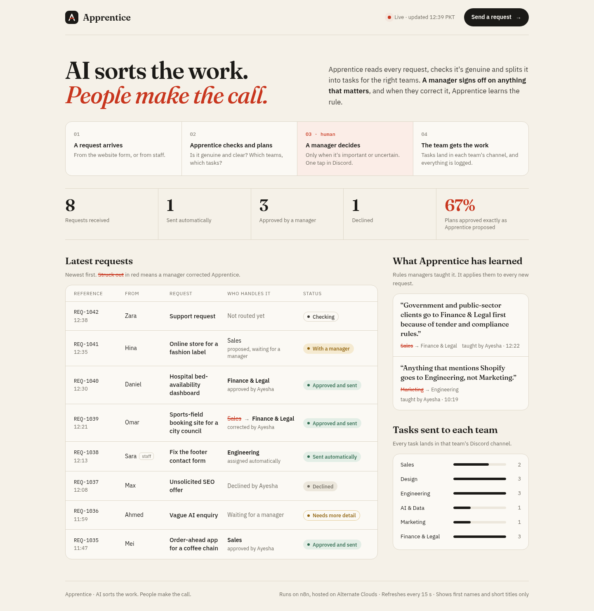

# Apprentice UI kit (for n8n 2.6.3)

Everything a person sees in Apprentice, ready to paste into n8n. Previewed and tested locally.



## What goes where
| File | Paste into | What people see |
|---|---|---|
| `board.n8n.js` | Workflow B: Webhook (GET `board`) → Data Table Get ×3 (**Get requests**, **Get tasks**, **Get rules**) → **Code** → Respond to Webhook (*Text*, body `{{ $json.html }}`, header `Content-Type: text/html; charset=utf-8`) | The live board and homepage: `…/webhook/board` |
| `form.css` | Both Form Triggers → Options → **Custom Form Styling** | Branded request forms |
| `form-copy.md` | Form titles, descriptions, fields, completion screens | Clear forms anyone can fill in |
| `review-form.json` | Discord **Send and Wait** → Custom Form → Define Form: *Using JSON* | The manager's decision form |
| `review-message.n8n.js` | A Code node right before each Send and Wait; its Message = `{{ $json.review_message }}` | The manager's review card in `#manager-review` |
| `team-messages.n8n.js` | A Code node before the HTTP Request that posts to team channels | Task cards in each team's channel, plus an ownership brief |
| `log-message.n8n.js` | A Code node after each path's final row update, before an HTTP Request | One line per request in `#apprentice-log` |

## Things the code expects
- **Node names:** Normalize, Rule checks, Verifier agent, Guardrails, Apply decision, Load departments (right after Normalize), Get requests, Get tasks, Get rules.
- **Verifier output** includes `title` (at most 6 words, no names or amounts), stored in the `requests` table. The board and messages show it.
- **Departments table:** one row per team with its Discord webhook, plus a row named `_log` for `#apprentice-log`. Rows starting with `_` are system channels, not teams.
- **Review decisions** use these exact strings: `Approve`, `Approve, but change the owner`, `Decline`, `It's fine, plan it`, `Ask for more detail`.

## Built-in safety
- Request text comes from strangers. Before it reaches a manager, @mentions are neutralised, markdown is escaped and links are defanged (`hxxp://`). Every webhook post sends `allowed_mentions: {parse: []}`.
- The public board shows first names and short titles only: never emails, budgets or request text.
- n8n 2.x serves webhook HTML in a sandbox (no cookies). The board needs no JavaScript: it's rendered by n8n and refreshes every 15 s.

## Preview and test locally
```bash
node product/ui/preview/render-preview.mjs   # writes board-preview.html (sample data) and board-empty.html
node product/ui/preview/test-messages.mjs    # runs the three Discord message nodes with mock data
```

## Design
Paper `#F5F1E8` · ink `#1B1A17` · **red pencil `#C8361E`**, used only for human corrections (struck-out choices, the logo's crossbar) · green `#2F6B4F` sent · ochre `#8F610A` waiting. Type: Fraunces (headings), IBM Plex Sans (text), IBM Plex Mono (references).
